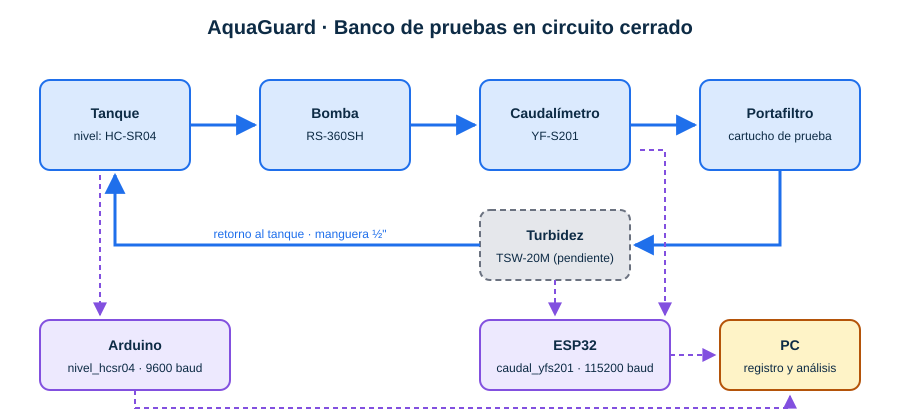

# AquaGuard

**Banco de pruebas de filtros para planta purificadora de agua (Arduino + ESP32).**

Proyecto integrador de segundo semestre. AquaGuard mide cuándo un filtro necesita lavarse de verdad en lugar de hacerlo por calendario.



## El problema

La planta purificadora que estudiamos recibe agua del acueducto (que llega turbia cuando llueve) y la pasa por tanques de arena y carbón, macrofiltración, microfiltración y lámparas UV.

Los filtros se lavan **cada semana** por recomendación del fabricante, sin ningún indicador de si realmente hace falta. Eso tiene dos costos:

- **Agua y tiempo perdidos** cuando se lava un filtro que todavía funcionaba bien.
- **Producción perdida** (bolsas de agua que no se alcanzan a producir) cuando un filtro se tapa antes de la fecha de lavado.

## La propuesta

Una maqueta en **circuito cerrado** que reproduce el paso del agua por un filtro y registra:

1. **Caudal** con y sin el cartucho de filtro, para estimar el **porcentaje de obstrucción**.
2. **Nivel del tanque**, para controlar el volumen del sistema.
3. **Turbidez** del agua a la salida del filtro *(en integración)*.

Con esos datos se busca estimar el momento óptimo de lavado y las pérdidas económicas de lavar antes o después de tiempo.

## Montaje

| Componente | Función |
|---|---|
| Tanque | Reserva de agua del circuito cerrado |
| Bomba RS-360SH | Impulsa el agua por el circuito |
| Caudalímetro YF-S201 | Mide el caudal (L/min) y el volumen acumulado |
| Portafiltro con cartucho | Filtro bajo prueba |
| Sensor de turbidez TSW-20M | Calidad del agua a la salida *(en integración)* |
| Sensor ultrasónico HC-SR04 | Nivel del tanque |
| Manguera transparente de ½" | Tubería del circuito |
| Arduino + ESP32 (con shield) | Adquisición de datos |

## Firmware

| Carpeta | Placa | Sensor | Qué hace |
|---|---|---|---|
| [`nivel_hcsr04/`](nivel_hcsr04/nivel_hcsr04.ino) | Arduino | HC-SR04 | Toma 5 lecturas, calcula la mediana y aplica un filtro exponencial (EMA, α = 0.2). |
| [`caudal_yfs201/`](caudal_yfs201/caudal_yfs201.ino) | ESP32 | YF-S201 | Cuenta pulsos por interrupción y calcula caudal y volumen acumulado cada 3 s. |

### Conexiones

**HC-SR04 → Arduino**

| HC-SR04 | Arduino |
|---|---|
| VCC | 5 V |
| TRIG | Pin 9 |
| ECHO | Pin 10 |
| GND | GND |

**YF-S201 → ESP32**

| YF-S201 | ESP32 |
|---|---|
| Rojo (VCC) | 5 V (VIN) |
| Amarillo (señal) | GPIO 27, **a través de un divisor de voltaje** |
| Negro (GND) | GND |

> ⚠️ **Importante:** el YF-S201 se alimenta a 5 V y su señal puede llegar a 5 V, pero los pines del ESP32 trabajan a **3,3 V**. Usa un divisor de voltaje entre la señal y el GPIO 27: **10 kΩ** de la señal al GPIO y **20 kΩ** del GPIO a GND (≈ 3,3 V).

### Formato de salida serial

- **Nivel** (9600 baudios): `distanciaCruda,distanciaFiltrada`, en cm.
- **Caudal** (115200 baudios): `FLOW,caudal_L_min,volumen_L,pulsos`.

Ejemplo de caudal:

```
AQUAGUARD - CAUDALIMETRO INICIADO
FLOW,2.133,0.1067,48
```

### Calibración

El YF-S201 usa `PULSOS_POR_LITRO = 450.0` como valor inicial. Para calibrarlo, haz pasar un volumen conocido (por ejemplo 1 L), anota los pulsos contados y reemplaza la constante.

### Cómo usarlo

1. Abre cada `.ino` en Arduino IDE.
2. Selecciona la placa (Arduino UNO / ESP32 Dev Module) y el puerto.
3. Carga el código y abre el Monitor Serie con la velocidad indicada.

## Estado del proyecto

- [x] Firmware de nivel (HC-SR04) con filtrado de lecturas
- [x] Firmware de caudal (YF-S201) con caudal y volumen acumulado
- [ ] Integración del sensor de turbidez TSW-20M
- [ ] Ensayos con y sin filtro y cálculo del % de obstrucción
- [ ] Estimación de pérdidas económicas para la planta

## Equipo

- Anderson David García Villamizar
- Juan Felipe Rincón Avella
- José Isnardo Díaz Castro
- Daniel Guillermo Tovar Preciado

**Docente:** Zalma Valentina Moreno Galeano

Tunja, Boyacá · 2026
